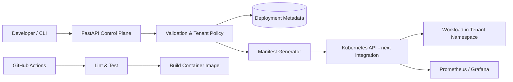

# CloudForge — Self-Service Kubernetes PaaS

CloudForge is a portfolio-grade starter project demonstrating platform engineering:
a small FastAPI control plane accepts application deployment requests, validates them,
and generates Kubernetes resources for an isolated tenant namespace.

> **Scope:** This repository is a demonstrator, not a production-ready multi-tenant
> PaaS. The API currently generates manifests and provides a dry-run workflow. A
> production deployment executor, authentication, policy enforcement, and secrets
> integration are documented as next steps.

## Architecture



## Features

- REST API for tenant and application deployment requests
- Pydantic request validation and safe Kubernetes naming
- Tenant namespace and Deployment/Service manifest generation
- CPU/memory resource requests and limits
- Docker-based local development
- Helm chart starter for deploying the control plane
- Kind cluster configuration for local multi-node Kubernetes
- Terraform starter for cloud infrastructure design
- GitHub Actions CI for linting and tests
- Prometheus scrape annotations and operational runbook

## Quick start (macOS / Linux)

Requirements: Python 3.11+, Docker, and optionally `kind` + `kubectl`.

```bash
git clone https://github.com/<your-github-username>/cloudforge-platform.git
cd cloudforge-platform

python3 -m venv .venv
source .venv/bin/activate
pip install -r requirements.txt

uvicorn app.main:app --reload
```

Open:
- API docs: http://127.0.0.1:8000/docs
- Health: http://127.0.0.1:8000/health

## Example API flow

Create a tenant:

```bash
curl -sS -X POST http://127.0.0.1:8000/tenants \
  -H 'Content-Type: application/json' \
  -d '{"name":"acme","display_name":"ACME Demo"}'
```

Request a deployment:

```bash
curl -sS -X POST http://127.0.0.1:8000/deployments \
  -H 'Content-Type: application/json' \
  -d '{
    "tenant":"acme",
    "app_name":"hello-api",
    "image":"nginx:1.27",
    "port":80,
    "replicas":2,
    "cpu_request":"100m",
    "memory_request":"128Mi",
    "cpu_limit":"500m",
    "memory_limit":"256Mi"
  }'
```

The response contains Kubernetes YAML documents. Save them and inspect before applying:

```bash
# Copy the returned manifest string into deploy.yaml, then:
kubectl apply --dry-run=client -f deploy.yaml
kubectl apply -f deploy.yaml
```

For a real cluster, configure an image registry, image pull secrets, TLS ingress,
authentication, authorization, quotas, network policies, and audit logging first.

## Local multi-node cluster with Kind

```bash
kind create cluster --config infra/kind/kind-config.yaml --name cloudforge
kubectl cluster-info --context kind-cloudforge
kubectl get nodes
```

Deploy the sample workload manifest generated by the API. Delete the cluster when done:

```bash
kind delete cluster --name cloudforge
```

## Run tests

```bash
pip install -r requirements-dev.txt
pytest -q
```

## Repository map

```text
app/                 FastAPI control plane and manifest generator
tests/               API and validation tests
infra/kind/          Local multi-node Kind cluster
helm/cloudforge/     Helm chart for the control plane
terraform/           Cloud infrastructure starter module
.github/workflows/   CI pipeline
docs/                Architecture, roadmap and demo script
```

## Security and production hardening

This is intentionally a safe demo. Before exposing it to customers:
1. Add OIDC authentication and tenant-scoped RBAC.
2. Run the control plane with a dedicated Kubernetes ServiceAccount.
3. Add namespace ResourceQuota, LimitRange, and NetworkPolicy.
4. Restrict permitted registries and image tags; scan images for vulnerabilities.
5. Store credentials in a secrets manager, never in Git or plain environment files.
6. Add admission policies (Kyverno or Gatekeeper), audit logs and rate limits.
7. Persist metadata in PostgreSQL and use a queue for asynchronous provisioning.
8. Add reconciliation, retries, deployment status and rollback workflows.

## Suggested demo narrative

1. Explain the control plane and tenant isolation.
2. Create a tenant using the API.
3. Submit an application deployment request.
4. Review the generated namespace, Deployment and Service manifests.
5. Apply the manifest to Kind and show the running pods.
6. Show CI checks and explain how the platform would evolve to cloud provisioning.

## License

MIT — see [LICENSE](LICENSE).


## Open-source platform stack (Helm)

CloudForge uses upstream Helm charts for platform capabilities rather than
reimplementing them. The optional platform stack includes:

- Traefik for ingress routing and Gateway API
- cert-manager for TLS certificate lifecycle
- kube-prometheus-stack for Prometheus, Alertmanager, Grafana and exporters
- Argo CD for GitOps delivery
- External Secrets Operator as an optional integration point

Create the local multi-node Kind cluster and install the stack:

```bash
kind create cluster --config infra/kind/kind-config.yaml --name cloudforge
./scripts/install-platform.sh
```

To include External Secrets Operator, set `INSTALL_EXTERNAL_SECRETS=true`.
See [platform/README.md](platform/README.md) for access instructions, security
notes and component responsibilities. Helm chart versions should be reviewed
and pinned in a production release process.
